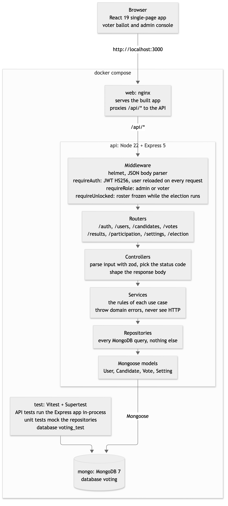
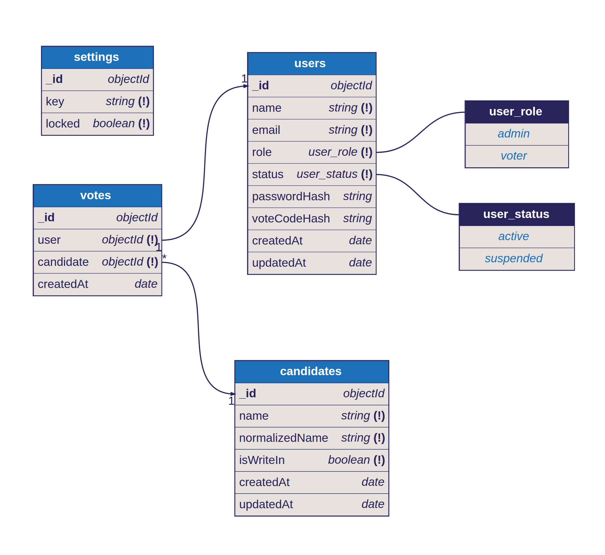

# Voting Application API

REST API for a small voting application. Administrators manage users and candidates and watch the count; voters sign in with their email and vote code and cast one vote, either for a name already on the ballot or for a name they type in.

Built with Express 5, MongoDB (Mongoose), JavaScript (ES modules) and JWT. Tests use Vitest and Supertest against a real MongoDB.

The web client lives in a separate repository, [`voting-apps-front`](../voting-apps-front). The `docker-compose.yml` in this repository runs both.

## Run it

The only requirement is Docker with Compose v2. Node and MongoDB run inside containers.

1. Clone both repositories next to each other:

   ```
   some-folder/
   ├── voting-apps-back/
   └── voting-apps-front/
   ```

   If the frontend lives somewhere else, set `FRONTEND_PATH` (see [Configuration](#configuration)).

2. From `voting-apps-back`, start everything:

   ```bash
   docker compose up --build
   ```

3. Open http://localhost:3000 to vote, or http://localhost:3000/admin/login to run the election. The API is also exposed at http://localhost:4000/api.

On first start the database is seeded with these accounts:

| Role | Email | Signs in with | State |
|---|---|---|---|
| Administrator | `admin@example.com` | password `admin12345` | |
| Voter | `siti@example.com` | vote code `STRH-4826` | Not voted |
| Voter | `dimas@example.com` | vote code `DMPR-7395` | Not voted |
| Voter | `eka@example.com` | vote code `EKPS-5942` | Voted for Dr. Endang Kusumawati |
| Voter | `ayu@example.com` | vote code `AYWD-2683` | Voted for Made Wirawan |

The ballot starts with Dr. Endang Kusumawati, Made Wirawan and Sri Wahyuni, and the demo election starts locked (running), so the two voters who have not voted can vote straight away. Without demo data the system starts unlocked, ready for preparation. Seeding only runs on an empty database. To start over:

```bash
docker compose down -v   # removes the database volume
docker compose up --build
```

## Run the tests

```bash
docker compose run --rm test                          # 114 tests
docker compose run --rm test npm run test:coverage    # with a coverage report
```

The `test` service uses its own `voting_test` database, so it never touches the app's data. `src` and `tests` are mounted into the container, so edits are picked up without a rebuild.

The suite was written test first: the git history shows each failing test file committed before the code that makes it pass.

## Configuration

Set these in a `.env` file next to `docker-compose.yml` (copy `.env.example`). All have working defaults for local use.

| Variable | Default | Purpose |
|---|---|---|
| `JWT_SECRET` | `dev-only-secret-change-me` | Signs tokens. **Set a long random value anywhere outside your own machine.** |
| `JWT_EXPIRES_IN` | `8h` | Token lifetime. |
| `ADMIN_NAME` / `ADMIN_EMAIL` / `ADMIN_PASSWORD` | `Arthur Vance` / `admin@example.com` / `admin12345` | First administrator, created on an empty database. |
| `SEED_DEMO` | `true` | Also seed the demo voters, candidates and votes. |
| `WEB_PORT` / `API_PORT` | `3000` / `4000` | Host ports. |
| `FRONTEND_PATH` | `../voting-apps-front` | Where the frontend repository is. |

## API

All routes are under `/api`. Send the token from either sign-in route as `Authorization: Bearer <token>`. Errors look like `{ "error": { "message": "...", "details": [{ "path": "email", "message": "..." }] } }`.

| Method and path | Who | What it does |
|---|---|---|
| `POST /auth/login` | voters | `{ email, code }` → `{ token, user }`. The code is case-insensitive and the dash is optional. 401 for wrong credentials, 403 if suspended. |
| `POST /auth/admin/login` | administrators | `{ email, password }` → `{ token, user }`. Same errors. |
| `GET /auth/me` | signed in | The current user, including `hasVoted`. |
| `GET /candidates` | signed in | Names on the ballot. Administrators also get `voteCount`. |
| `POST /candidates` | admin | `{ name }`. 409 if the name already exists (case and spacing ignored). |
| `DELETE /candidates/:id` | admin | 409 if the candidate has votes. |
| `POST /votes` | voter | `{ candidateId }` or `{ name }` for a write-in. 409 if already voted. 423 while the system is unlocked (election not started). |
| `GET /votes/me` | voter | The voter's own vote, or `null`. |
| `GET /results` | admin | Total votes, turnout and every candidate's count, highest first. |
| `GET /participation` | admin | Voters who have voted and when, newest first. Never includes their choice. |
| `GET /users?search=&voted=` | admin | Users with voting status. `search` matches name or email; `voted` is `true` or `false`. |
| `POST /users` | admin | Voter: `{ name, email }` → `{ user, voteCode }`. Administrator: `{ name, email, role: "admin", password }`. |
| `PATCH /users/:id` | admin | Any of `name`, `email`, `status`, and `password` for administrators. Roles cannot change. |
| `POST /users/:id/vote-code` | admin | Issues a new vote code for a voter → `{ voteCode }`. The old code stops working. |
| `DELETE /users/:id` | admin | Deletes the user and their vote. |
| `DELETE /users/:id/vote` | admin | Clears a vote so that voter can vote again. |
| `GET /settings` | signed in | `{ locked }`. Voters use it to know whether voting has started. |
| `PUT /settings` | admin | `{ locked }`. Locking starts the election; unlocking closes voting and returns to preparation. |
| `POST /election/reset` | admin | Deletes all votes and write-in names → `{ votesRemoved, writeInsRemoved }`. 423 while the system is locked (election running). |
| `GET /health` | anyone | Liveness check. |

## How it behaves

- **One vote per voter.** `votes.user` has a unique index, so the database rejects a second vote even when two requests arrive at the same moment. A test fires five at once and expects exactly one to succeed.
- **Write-ins join the ballot.** A typed name is trimmed, its spaces collapsed and compared case-insensitively with existing names. `"made  WIRAWAN"` counts for Made Wirawan; a new name becomes a candidate that later voters can pick.
- **Vote codes instead of voter passwords.** Creating a voter generates an 8-character code such as `K7QM-4XPR`, using letters and digits that cannot be confused (no 0/O or 1/I/L). The API returns it once; only a bcrypt hash is stored. If a voter loses it, an administrator issues a new one.
- **Separate sign-in for administrators.** Administrators use a password on `/auth/admin/login`; voter credentials never work there, and the other way round. A role is fixed when the account is created.
- **Administrators do not vote.** Turnout counts active voters only. Administrators cannot suspend or delete themselves, so the console always keeps an owner.
- **System lock is the election switch.** Unlocked means the administrator is preparing: users and candidates can be changed, and votes get 423. Locked means the election is running: voters can vote, and users and candidates are frozen (423) so nobody can change the roster mid-election. Voters can read the lock state, so the ballot tells them when voting has not started.
- **Election reset.** An administrator can start over: every vote and every write-in name is deleted, while voters, their vote codes and the names added by administrators stay. It only runs while the system is unlocked (423 otherwise), when voting is closed and no vote can arrive halfway through.
- **Suspended accounts** cannot sign in, and their existing tokens stop working on the next request, because every request reloads the user. Their vote, if any, still counts.
- **Who voted for whom.** A vote stores the voter so it can be reset or removed with the account. No endpoint shows another person's choice: administrators see totals, and the participation list says only who voted and when.
- **Passwords and vote codes** are hashed with bcrypt. Sign-in takes the same time whether or not the email exists.

## Architecture

### System



### Database



## How the code works

Every request passes through the same layers, top to bottom:

```
HTTP request
  → app.js          helmet, JSON body parser (10 kB limit), one router per resource
  → middleware/     requireAuth, requireRole, requireUnlocked
  → routes/         parse the input with zod, apply the rules of that use case
  → models/         Mongoose models, data rules, public shapes
  → MongoDB
  ← errorHandler    turns anything thrown on the way into the JSON error shape
```

### Startup

`server.js` is the only file that touches the outside world when it loads. Importing `config.js` parses `process.env` with zod, so a missing `JWT_SECRET` or a malformed value stops the process before anything listens. The server then connects to MongoDB, seeds the database if it has no users yet (`seed.js`), and starts listening. On `SIGTERM` or `SIGINT` it stops accepting connections, closes the database connection and exits, so `docker compose down` does not cut requests off halfway.

### A request, step by step

Casting a vote (`POST /api/votes`) goes through every layer:

1. `app.js` mounts the votes router behind `requireAuth` and `requireRole('voter')`. Who may call what is decided there, in one list, before any route code runs.
2. `requireAuth` reads the bearer token, checks its signature (`auth/token.js`) and loads the user from the database. Because the user is reloaded on every request, a suspended or deleted account is shut out at once, not when its token expires. The user is attached to `req.user`.
3. `requireRole('voter')` turns administrators away with 403.
4. The route parses the body with a zod schema: either `candidateId` or a write-in `name`, never both. A write-in name is trimmed, its spaces collapsed and its characters checked as part of parsing, so the code after it only ever sees clean input.
5. The route checks the rules that need the database: the system must be locked (423 otherwise) and the voter must not have voted yet (409).
6. It finds the candidate by id, or calls `findOrCreateWriteIn` in `models/candidate.js`. That function upserts on the normalised name, so two voters writing in the same new name at the same moment end up with one candidate.
7. It creates the vote. The unique index on `votes.user` is the real guarantee of one vote per voter: if two requests both passed step 5, the second insert fails with a duplicate key error, which becomes 409.
8. It answers with `toPublicCandidate(...)`, the model's public shape, never the raw document.

Reads take the same path with fewer steps. Results are not stored anywhere: `GET /results` counts votes per candidate with an aggregation on every request. Totals can never drift from the votes that exist, and deleting a user, resetting one vote or resetting the election needs no extra bookkeeping.

### Errors

Any layer can `throw new HttpError(status, message)` (`errors.js`). Express 5 hands errors thrown in async handlers to the error handler, so routes need no `try/catch` or `next(err)` for the common case; they only catch the duplicate key errors they want to turn into 409. `middleware/error.js` maps whatever arrives to one response shape:

| Thrown | Response |
|---|---|
| `HttpError` | its own status and message |
| `ZodError` | 400 `Validation failed`, with one `details` entry per invalid field |
| Mongoose `CastError` (a malformed id) | 400 `Invalid <field>` |
| a body that is not valid JSON | 400 `Malformed JSON body` |
| anything else | 500 `Internal server error`; the real error is logged on the server and never sent to the client |

Unknown routes reach `notFound`, which passes a 404 `HttpError` to the same handler.

## Why it is structured this way

- **`app.js` builds the app, `server.js` runs it.** The tests call `createApp()` and drive it with Supertest in the same process: no port, no seeding on start, no shutdown handling. Everything with side effects lives in `server.js`, the one file the tests never load.
- **Access rules sit in one place.** `app.js` reads like the table in [API](#api): each router is mounted with the guards it needs. A router only adds its own guard where one resource serves two audiences, such as `GET /candidates` for everyone but `POST /candidates` for administrators only.
- **Routes are thin, one file per resource.** A handler parses its input, applies the rules of that use case and shapes the answer. There is no separate controller or service layer: with one database and about twenty endpoints, an extra layer would mostly forward calls. If the API grew, logic shared by several routes would move into its own module first.
- **Models own the data rules.** Each model file holds the schema, the indexes that enforce invariants (unique email, one vote per user, unique normalised candidate name), the hooks that normalise names, and the `toPublic...` function that decides what leaves the API. Password and vote-code hashes never leave the database, because no route sends a raw document.
- **The database guards what must never break.** Checks in route code give clear, early errors, but unique indexes are what keep one vote per voter and one candidate per name true under simultaneous requests. The tests fire requests at the same moment to prove it.
- **Validation at the edge.** zod schemas parse `req.body` and `req.query` at the top of each handler and hand back clean values. Code below that point never re-checks shapes, and every validation failure has the same error format.
- **Small helpers without state.** `auth/` holds password hashing, JWT signing and vote-code generation as plain functions, reused by routes, seeding and test helpers alike.
- **Configuration is read once.** `config.js` validates the environment at start and exports a plain object. Nothing else in `src` reads `process.env`, so a bad setting fails at boot rather than on the first request that needs it.
- **Plain JavaScript, no build step.** The source is ES modules that Node runs directly (`node src/server.js`), and the Docker image copies `src` and starts it. What you read is what runs.

## Layout

```
src/
  app.js            Express app (no listen), used by tests and the server
  server.js         connects to MongoDB, seeds, listens
  config.js         environment variables, validated with zod
  seed.js           first-run data
  auth/             password hashing, JWT helpers
  middleware/       auth and role guards, lock guard, error handler
  models/           user, candidate, vote, setting
  routes/           one file per resource
tests/              one file per resource, plus shared helpers and setup
```

## Without Docker

With Node 22.12+ and a MongoDB you run yourself:

```bash
npm install
JWT_SECRET=dev SEED_DEMO=true npm run dev          # http://localhost:4000
MONGO_URL=mongodb://localhost:27017/voting_test npm test
```
